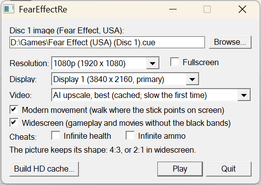
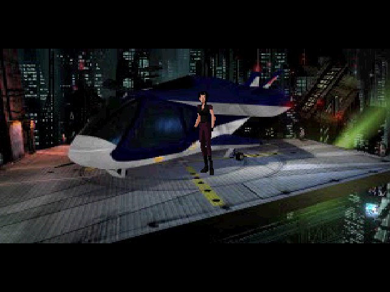
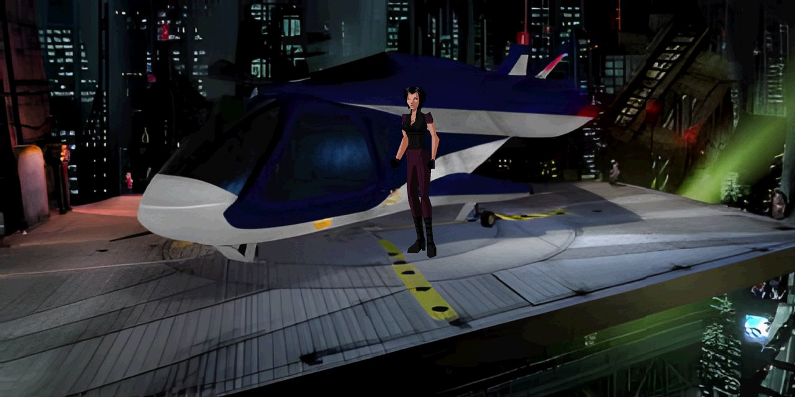
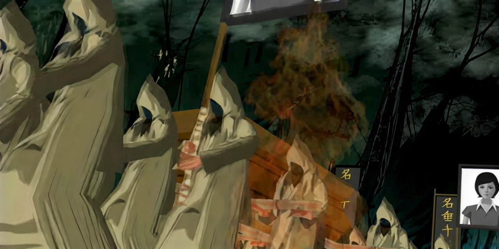
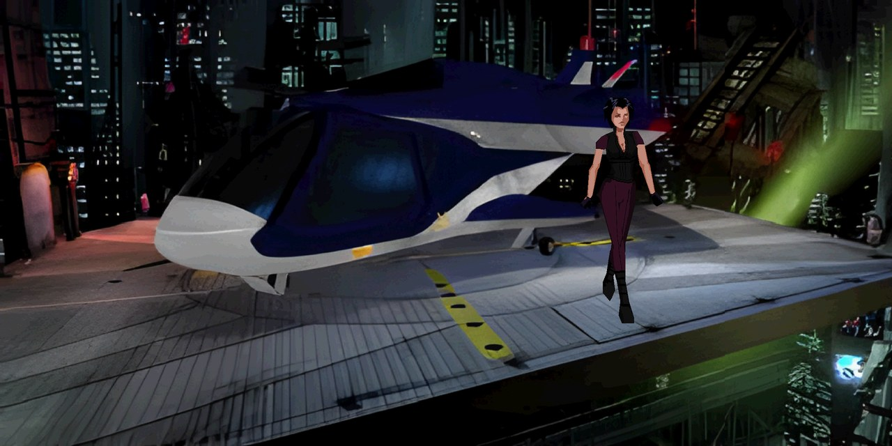

# FearEffectRe

*Fear Effect* (PlayStation, 2000, USA release) running natively on Windows, with the
improvements a modern PC can give it: sharp high-resolution 3D, widescreen, AI-enlarged
movies and backgrounds, optional modern controls and the game's own cheats.

It is a static recompilation: the game's MIPS code is translated to C++ and compiled for
the PC, and runs against a small PlayStation runtime instead of an emulated CPU. You need
your own discs (BIN/CUE or ISO); the program reads the movies, backgrounds, models and
sound from them.

This project is not affiliated with or endorsed by the owners of *Fear Effect*.



## What is different from the original

### High-resolution 3D

The PlayStation draws everything at 240 lines. Here characters, objects, the HUD and text are
drawn at a multiple of that which fills your screen: 3x for 720p, 5x for 1080p, 6x for 1440p,
9x for 4K (`--scale N` sets it directly).


*Left: the original 240-line picture, enlarged. Right: the same frame drawn at 5x.*

### Widescreen

The game is already a widescreen game: gameplay and movies are a 2:1 picture with black bands
above and below, inside a 4:3 frame. With **Widescreen** on, the bands are left out and the
picture fills the width of the screen. The HUD, which the game draws in the top band, is laid
over the picture instead. The title screen and menus, which use the whole frame, stay 4:3; the
switch is automatic.

**Original, 4:3 with black bands:**



**FearEffectRe, widescreen at 1080p with AI backgrounds:**



### AI-enlarged movies and backgrounds

The movies and the pre-rendered backgrounds behind the gameplay are 320x160 video on the disc.
The **Video** setting chooses how they are enlarged:

- **Original**: as they are, in large blocks.
- **AI upscale, fast**: a small Real-ESRGAN video model enlarges each picture 4x on the
  graphics card while you play.
- **AI upscale, best**: the large Real-ESRGAN x4plus model. It takes about half a second per
  picture, so the results are kept in an HD cache (`hdcache/hdcache.pack`) and reused.
  **Build HD cache...** enlarges every movie and background frame of all four discs ahead of
  time: several hours and about 300 GB of disk; it can be stopped and resumed. Pictures
  missing from the cache are enlarged when first shown, which slows the game down.
- **AI upscale, SeedVR2** (`seedvr2`): SeedVR2 3B, a video model: it enlarges frames in
  groups, so movies are steadier and cleaner than with x4plus. It is far too slow to run
  while playing, so it only shows pictures from its own cache, `hdcache/seedvr2.pack`;
  anything missing is shown as on the console, never from another model. With SeedVR2
  selected, **Build HD cache...** (or `--build-seedvr2-cache`) builds it for every disc found
  next to disc 1: about two days on an RTX 3090 and about 300 GB. Each disc is marked as
  done when it is complete; starting or inserting a disc that is not says so. SeedVR2 needs
  an NVIDIA graphics card; the launcher offers to install it in `ai/seedvr2` the first time
  it is chosen (see [tools/ai/README.md](tools/ai/README.md)).

The AI modes need a DirectX 12 graphics card.

| Original | AI upscale, best | AI upscale, SeedVR2 |
|---|---|---|
|  |  |  |

Videos of the three modes side by side, captured at 4K:

| Intro movie | Opening cutscene |
|---|---|
| [](https://youtu.be/nXTX44fFRds) | [](https://youtu.be/PY5YANKhIxA) |

### Modern movement (optional)

The original uses tank controls: up walks forward, left and right turn on the spot. With
**Modern movement** on, you push the stick or D-pad toward where you want to go *on the screen*
and the character turns that way and walks, whatever the camera angle. The Xbox controller's
left stick works in any direction; the keyboard and D-pad give eight.



The pause screen and other menus keep the normal D-pad, and wherever the program cannot tell
where the camera is, the original controls stay in effect. It works by reading the
character's facing and the camera from the running game, and has only been checked in the
first area of disc 1.

### Cheats

**Infinite health** and **Infinite ammo** switch on the game's own cheats (the ones the
published GameShark codes `80077810 0002` and `0001` enable). With infinite ammo the spare
ammunition never runs out; the gun still reloads when its clip is empty.

**More cheats...** in the launcher lists the 192 cheats of DuckStation's cheat database for
Fear Effect (weapons and items for each character, stop time, no fear and more): tick the ones
to use, or type in **Find** to narrow the list. The first time, it offers to download the list
from [github.com/duckstation/chtdb](https://github.com/duckstation/chtdb) into the `cheats`
folder next to the program; the cheats are by their authors and are not part of this
repository. The ones chosen are kept in `cheats/enabled.txt`. Some cheats can stop the game from
working properly; turn them off if it misbehaves.

A few cheats change the game's code rather than its data (Infinite Ammo, Stop Time, No Fear).
The recompiled code never reads the game's instructions back from memory, so the functions
they change run in the interpreter instead while the cheat is on, which makes them slower.

### Precise 3D models

The PlayStation rounds every corner of a 3D model to a whole pixel of its 320x240 picture, so
models wobble and shimmer as they move; drawn at a higher resolution, the rounding shows even
more. With **Precise 3D models** (`--precise`) the corners are placed where they really are in
the high-resolution picture. The game itself sees nothing different.

It works like PGXP in other emulators: when the geometry engine projects a point, the exact
position is kept next to the rounded one; when the game stores that point to memory and the
graphics chip later reads that same word, the exact position goes with it. A model is built
from parts transformed one by one, and where two parts meet, the same point comes out slightly
differently from each; points that round to the same pixel in a frame therefore share one
exact position, so the parts stay joined.

### Smooth 60 fps

The game draws a new picture every second frame: 30 a second. With **Smooth 60 fps**
(`--smooth`, which also turns on precise 3D models) a picture is drawn in between each two of
the game's, with every 3D polygon halfway between where it was in the one before and where it
is in the next. Each picture the game draws is recorded: the frame buffer as it is just before
the first 3D polygon (the background and the 2D parts are already there), then every drawing
command after that. The in-between frame draws the newer picture again from that point, with
each polygon moved halfway back to the same polygon of the picture before (the same kind of
polygon with the same texture, nearest to it). When too few polygons match, at a camera cut or
a new screen, the game's own picture is shown instead. Movies and menus are shown as they are.

To be halfway between two pictures, the in-between frame has to wait for the second, so the
game's pictures are shown 1/60 of a second later than without it.

### Fixes for the game's own bugs

The movie and background decoder of the game can be told to carry on with a picture it has
already finished, from a stale position, writing over memory that has been reused since
(found by project-helix, whose fix this is). The fix leaves the decoder's state as "finished"
whenever a picture is done, so a stale "carry on" does nothing. In the first 14,000 frames
(boot, intro, opening and the first area) the game never does this, but other places may.
`--no-game-fixes` leaves it as it is; the report at the end says how often it happened.

### Save states

F6 saves the whole game at the moment you press it and F7 brings it back, anywhere, not only
where the game lets you save. There are nine slots: F8 picks the next one, Shift+F8 the
previous one. They are files in the `states` folder (`--states dir` keeps them elsewhere), and a
state remembers which disc was in the drive.

### Everything else

- **Smoother on a PC**: the renderer uses several CPU threads and OpenGL to show the picture.
- **Saves are files**: the memory card in slot 1 is a `saves` folder, one file per save.
- **Disc changes** are a key press (F2 to F5), the other discs are found next to the first.
- **Fast-forward** with F1.
- **Window or fullscreen**: F11 or Alt+Enter switches while playing.
- **Faster loading** (optional): `--cd-speed 4` reads the disc four times as fast (up to 8).
  Movies, the moving backgrounds and the music still play at their own speed.
- **Keyboard, Xbox controller or any other game controller** (DualShock 4, DualSense, USB
  pads), no adapter needed. The buttons can be changed in the **Controls** window (F9 in the
  game, or **Controls...** in the launcher).
- **Analog pad** (optional): the game sees a DualShock in analog mode and reads its left stick.
- **Sound**: volume, mute and latency in `FearEffectRe.ini` or on the command line.
- **More cheats**: DuckStation's cheat list for Fear Effect, chosen in the launcher, or any
  DuckStation `.cht` file (`--cheats file.cht`).
- **Disc check**: `--verify-disc` compares the four disc images with the Redump dumps and checks
  every sector for damage, so a good image that is not the Redump dump can be told from a bad one.

## Playing

Download the latest release, unzip it anywhere and run `FearEffectRe.exe`. In the launcher,
choose your disc 1 image, a resolution (Original 640x480, 720p, 1080p, 1440p or 4K),
fullscreen, the display (with more than one monitor), the video mode and the options above,
then press **Play**. The choices are remembered in `FearEffectRe.ini` next to the program.

| PlayStation | Keyboard | Xbox controller | Other controller (DualShock 4 / DualSense) |
|---|---|---|---|
| D-pad | Arrows or WASD | D-pad or left stick | D-pad or left stick |
| Cross | E or Enter | A | Cross |
| Circle | Q or Esc | B | Circle |
| Square | F | X | Square |
| Triangle | Space | Y | Triangle |
| L1 / R1 | Tab / R | LB / RB | L1 / R1 |
| L2 / R2 | 1 / 4 | LT / RT | L2 / R2 |
| Start / Select | P / Backspace | Start / Back | Options / Share |

Other controllers are read through Windows' game controller support while no Xbox controller is
connected. Their buttons are numbered by the controller (`Button1` to `Button32` and the hat
`PovUp` ... `PovLeft`); the defaults follow a DualShock 4 or DualSense. For another controller,
set its buttons in the Controls window.

F1 fast-forwards, F2 to F5 insert disc 1 to 4 (found next to the first by their `(Disc N)`
name), F6 saves a state, F7 loads it, F8 / Shift+F8 change the slot, F9 opens the Controls
window (the game waits meanwhile), F11 or Alt+Enter switches between a window and fullscreen.

### Controls and sound settings

In the Controls window, click a box and press a key or controller button to add it to that
PlayStation button (or to take it off, if it is there already); right-click a box to empty it.
**Save** keeps the changes in `FearEffectRe.ini`, where they can also be edited by hand. Each
PlayStation button takes a list of keys and a list of controller buttons:

```ini
[keyboard]
cross=E, Enter
circle=Q, Esc
[controller]
cross=A, Button2
l2=LT, Button7
deadzone=37
stick_as_dpad=1
analog=0
[audio]
volume=100
mute=0
latency=100
```

Keys are letters, digits, `Up` `Down` `Left` `Right` `Enter` `Esc` `Space` `Tab` `Backspace`
`LShift` `RShift` `LCtrl` `RCtrl` `Alt` `Home` `End` `PageUp` `PageDown` `Insert` `Delete`
`F10` `F12` `Numpad0`-`Numpad9` `Comma` `Period` `Semicolon` `Slash` `Minus` `Equals`
`LBracket` `RBracket` `Quote` `Backslash`. Controller buttons are `A` `B` `X` `Y` `LB` `RB`
`LT` `RT` `Back` `Start` `LS` `RS` `DPadUp` `DPadDown` `DPadLeft` `DPadRight` (Xbox) and
`Button1`-`Button32` `PovUp` `PovDown` `PovLeft` `PovRight` (other controllers). The buttons are `select` `start` `up` `down` `left` `right` `l1` `r1`
`l2` `r2` `triangle` `circle` `cross` `square` (and `l3` `r3`, which this game does not use).
`deadzone` is how far the left stick has to move (percent) and `stick_as_dpad=0` stops it
pressing the D-pad. `analog=1` (or `--analog`) makes the pad a DualShock in analog mode: the
game reads the left stick itself: pushed fully, Hana walks as with the D-pad; pushed less, she
moves more slowly. With modern movement on as well, the stick still sets her speed. `latency` is how much sound is queued ahead, in milliseconds (40 to 340):
lower is more immediate, higher is safer on a busy PC.

The same can be given on the command line, which starts the game directly:

```sh
FearEffectRe "D:/path/Fear Effect (USA) (Disc 1).cue" --resolution 1080p --fullscreen --display 2 \
    --video best --widescreen --modern --infinite-health --infinite-ammo
```

`--saves dir` keeps saves in another folder, `--saves none` plays without a memory card.
`--volume 0-100`, `--mute` and `--audio-latency MS` override the ini file, `--cd-speed N`
loads faster, `--load-state FILE` starts from a save state.

`--cheats file.cht` applies the cheats of a DuckStation cheat file every frame: all of them, or
only the ones named with `--cheat "Name"` (repeat it for several; a cheat in a group is named
`Group\Name`). Codes 80, 30 and 90 (write 16, 8 and 32 bits), 10, 11, 20 and 21 (add and
subtract) and D0 to D3, E0 to E3 (conditions) are supported; a cheat with any other code is
left out.

`--record file` writes the controller input of every frame (and disc changes) to a text file,
and `--replay file` plays the game with exactly that input again, which reproduces the session
frame for frame. A recording remembers whether the pad was analog and modern movement was on, and
is played back the same way. Record from the start of the game, not after loading a state.

## Status

Playable from boot into gameplay: logo and intro movies, title screen, main menu, the load
screen, the opening cinematic and controllable gameplay with the HUD and pause menu. A
scripted run of 50,000 frames (about 14 minutes of play on disc 1) finishes without a crash.

Not checked yet: sound by ear, saving a game through the menus, the disc change prompts, and
anything past the first area. There is no reverb.

| Part | State |
|---|---|
| Disc images (BIN/CUE, ISO), ISO9660 | Working |
| MIPS to C++ recompiler | Working: 1268 functions, 89,373 instructions; all four discs share one executable |
| Interpreter (fallback and test oracle) | Working |
| BIOS (A0/B0/C0 calls, events, interrupt dispatch) | The calls the game uses |
| Interrupts, DMA, root counters | Working; root counter interrupts are not implemented (the game has not asked for them) |
| CD-ROM controller | Data, streaming and XA audio sectors; disc change |
| MDEC (movies and backgrounds) | Working |
| GPU | Software renderer, 1x to 16x internal resolution, multithreaded; no dithering, no texture filtering, edge rules not pixel-exact |
| Geometry engine (GTE) | All commands; not verified against hardware test vectors |
| SPU | 24 voices, envelopes, XA audio; no reverb, noise or pitch modulation |
| Controller | Digital pad, or DualShock in analog mode, in port 1 from the keyboard or a controller; no vibration |
| Memory card | Slot 1 as files in `saves/` |
| Overlays loaded from the disc | Run in the interpreter; not recompiled yet |

## Building

Requires CMake 3.25+, a C++20 compiler, Ninja and Python 3.

```sh
cmake -S . -B build -G Ninja -DFE_DISC_IMAGE="D:/path/Fear Effect (USA) (Disc 1).cue"
cmake --build build
```

Nothing from the game is stored in this repository: the C++ is generated from your disc image
into the build directory. Without `FE_DISC_IMAGE` only the interpreter is built. With MinGW,
keep the compiler's `bin` directory on `PATH` when running the programs.

For AI upscaling add `-DFE_AI_DIR=<folder>` pointing at a folder prepared as described in
[tools/ai/README.md](tools/ai/README.md); it is copied next to the program as `ai`.

### Testing without a window

```sh
build/FearEffectRe disc.cue --frames 3000 --input "500:start,1300:start,2000:up*300" --shots out --every 250
```

`--frames N` runs headless for N frames and prints a report: where it stopped, the game's
console output, calls and devices that are not implemented, and the busiest hardware
registers. `--input` presses buttons at given frames (`*n` holds for n frames; with
`--analog`, `stick-n` `stick-s` `stick-e` `stick-w` push the left stick), `--shots`
writes a PNG every `--every` frames (`--hd-shots` at the internal resolution), `--dump` and
`--dump-vram` write the last picture and video memory, `--ram dir` writes main memory next to
each screenshot (from frame `--ram-from N`; for finding game variables), `--wav` writes the
sound, `--swap frame:disc` changes disc, `--save-state-at frame:file` and
`--load-state-at frame:file` write and load a save state while running. `--interpreter` runs without the recompiled code;
`--log-bios`, `--log-cd N` and `--log-sio N` trace calls and register accesses.

```sh
ctest --test-dir build
```

`fe_difftest` runs every recompiled function and the interpreter from the same pseudo-random
registers and memory. Calls and hardware accesses are recorded instead of executed. Both sides
must record the same sequence and finish with the same registers and memory.

### Layout

- `tools/psxdisc.py` lists and extracts files from a disc image.
- `tools/recomp/` is the recompiler: `mips.py` decodes instructions, `analyze.py` finds
  functions and jump tables, `emit.py` writes the C++.
- `src/core/disc` reads disc images. `src/core/psx` is the machine: memory, interpreter,
  BIOS, CD-ROM, GPU, GTE, MDEC, SPU and the other hardware. `src/core/recomp/Runtime.h` is
  what generated code is written against.
- `src/app` is the program: the launcher, the window, the AI upscaler, modern controls and
  the headless runner. `tests` holds the differential test.

### How the recompiled code runs

Each guest function is a C++ function taking the CPU state. Branches inside a function are
gotos, delay slots are folded into their branch, direct calls are C++ calls, and `jalr`, BIOS
vectors and unresolved jumps go through a dispatcher that falls back to the interpreter for
code that was not recompiled. Cycles are charged per straight-line block; when a time slice
runs out the machine advances hardware and delivers interrupts. An interrupt saves the CPU
state, runs the game's handler to `ReturnFromException`, and restores it.

A function normally returns to the address its caller put in `ra`. The game's movie bitstream
decoder is hand-written and uses `ra` as a continuation; when a call comes back at a different
address the interpreter carries on from there until execution reaches the call site's return
address.

Known simplifications: load delay slots and arithmetic overflow traps are not modelled (the
executable was scanned and does not depend on load delays), every instruction costs two
cycles, and `longjmp` is not supported.

Save states have to cope with the guest's calls living on the host's C++ stack. A state is
taken only at a point where the whole guest state is in the machine: at the start of a
straight-line block, when its time slice runs out (the block's address is stored in `pc` just
before), outside interrupt handlers and BIOS event callbacks. Loading throws an exception that
unwinds every host frame, restores the machine, and starts the interpreter at the saved `pc`.
It runs the rest of the interrupted functions and hands over to recompiled code at the next
call. A run that loads a state continues frame for frame like the run that saved it.
