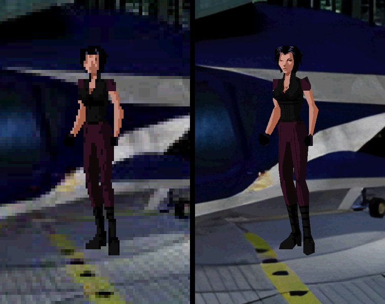
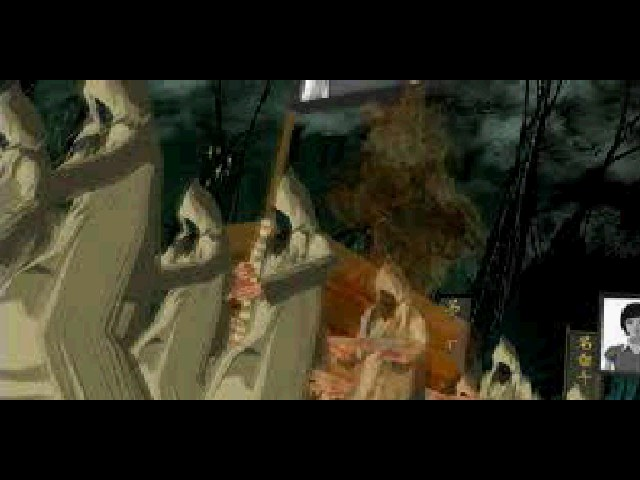
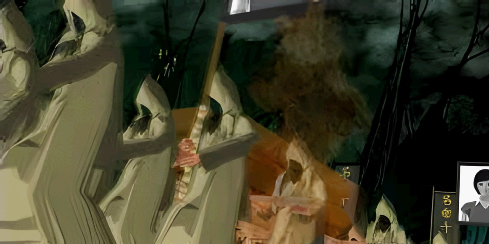

# FearEffectRe

*Fear Effect* (PlayStation, 2000, USA release) running natively on Windows, with the
improvements a modern PC can give it: sharp high-resolution 3D, widescreen, AI-enlarged
movies and backgrounds, optional modern controls and the game's own cheats.

It is a static recompilation: the game's MIPS code is translated to C++ and compiled for
the PC, and runs against a small PlayStation runtime instead of an emulated CPU. You need
your own discs (BIN/CUE or ISO); the program reads the movies, backgrounds, models and
sound from them.

This project is not affiliated with or endorsed by the owners of *Fear Effect*.


## What is different from the original

### High-resolution 3D

The PlayStation draws everything at 240 lines. Here characters, objects, the HUD and text are
drawn at a multiple of that which fills your screen: 3x for 720p, 5x for 1080p, 6x for 1440p,
9x for 4K (`--scale N` sets it directly).



*Left: the original 240-line picture, enlarged. Right: the same frame drawn at 5x.*

### Widescreen

The game is already a widescreen game: gameplay and movies are a 2:1 picture with black bands
above and below, inside a 4:3 frame. With **Widescreen** on, the bands are left out and the
picture fills the width of the screen. The HUD, which the game draws in the top band, is laid
over the picture instead. The title screen and menus, which use the whole frame, stay 4:3; the
switch is automatic.

**Original, 4:3 with black bands:**


**FearEffectRe, widescreen at 1080p with AI backgrounds:**


### AI-enlarged movies and backgrounds

The movies and the pre-rendered backgrounds behind the gameplay are 320x160 video on the disc.
The **Video** setting chooses how they are enlarged:

- **Original**: as they are, in large blocks.
- **AI upscale, fast**: a small Real-ESRGAN video model enlarges each picture 4x on the
  graphics card while you play.
- **AI upscale, best**: the large Real-ESRGAN x4plus model. It takes about half a second per
  picture, so the results are kept in an HD cache (`hdcache/hdcache.pack`) and reused.
  **Build HD cache...** enlarges every movie and background frame of all four discs ahead of
  time: several hours and about 300 GB of disk; it can be stopped and resumed. Pictures
  missing from the cache are enlarged when first shown, which slows the game down.
- **AI upscale, SeedVR2** (`seedvr2`): SeedVR2 3B, a video model: it enlarges frames in
  groups, so movies are steadier and cleaner than with x4plus. It is far too slow to run
  while playing, so it only shows pictures from its own cache, `hdcache/seedvr2.pack`
  (x4plus fills in anything missing). With SeedVR2 selected, **Build HD cache...** (or
  `--build-seedvr2-cache`) builds it: about two days on an RTX 3090 and about 300 GB.
  It needs a CUDA graphics card and SeedVR2 installed in `ai/seedvr2`
  (see [tools/ai/README.md](tools/ai/README.md)).

The AI modes need a DirectX 12 graphics card.

| Original | AI upscale, best |
|---|---|
|  |  |

### Modern movement (optional)

The original uses tank controls: up walks forward, left and right turn on the spot. With
**Modern movement** on, you push the stick or D-pad toward where you want to go *on the screen*
and the character turns that way and walks, whatever the camera angle. The Xbox controller's
left stick works in any direction; the keyboard and D-pad give eight.


The pause screen and other menus keep the normal D-pad, and wherever the program cannot tell
where the camera is, the original controls stay in effect. It works by reading the
character's facing and the camera from the running game, and has only been checked in the
first area of disc 1.

### Cheats

**Infinite health** and **Infinite ammo** switch on the game's own cheats (the ones the
published GameShark codes `80077810 0002` and `0001` enable). With infinite ammo the spare
ammunition never runs out; the gun still reloads when its clip is empty.

### Everything else

- **Smoother on a PC**: the renderer uses several CPU threads and OpenGL to show the picture.
- **Saves are files**: the memory card in slot 1 is a `saves` folder, one file per save.
- **Disc changes** are a key press (F2 to F5), the other discs are found next to the first.
- **Fast-forward** with F1.
- **Keyboard and Xbox controller**, no adapter needed.

## Playing

Download the latest release, unzip it anywhere and run `FearEffectRe.exe`. In the launcher,
choose your disc 1 image, a resolution (Original 640x480, 720p, 1080p, 1440p or 4K),
fullscreen, the display (with more than one monitor), the video mode and the options above,
then press **Play**. The choices are remembered in `FearEffectRe.ini` next to the program.

| PlayStation | Keyboard | Xbox controller |
|---|---|---|
| D-pad | Arrows or WASD | D-pad or left stick |
| Cross | E or Enter | A |
| Circle | Q or Esc | B |
| Square | F | X |
| Triangle | Space | Y |
| L1 / R1 | Tab / R | LB / RB |
| L2 / R2 | 1 / 4 | LT / RT |
| Start / Select | P / Backspace | Start / Back |

F1 fast-forwards, F2 to F5 insert disc 1 to 4 (found next to the first by their `(Disc N)`
name).

The same can be given on the command line, which starts the game directly:

```sh
FearEffectRe "D:/path/Fear Effect (USA) (Disc 1).cue" --resolution 1080p --fullscreen --display 2 \
    --video best --widescreen --modern --infinite-health --infinite-ammo
```

`--saves dir` keeps saves in another folder, `--saves none` plays without a memory card.

## Status

Playable from boot into gameplay: logo and intro movies, title screen, main menu, the load
screen, the opening cinematic and controllable gameplay with the HUD and pause menu. A
scripted run of 50,000 frames (about 14 minutes of play on disc 1) finishes without a crash.

Not checked yet: sound by ear, saving a game through the menus, the disc change prompts, and
anything past the first area. There is no reverb.

| Part | State |
|---|---|
| Disc images (BIN/CUE, ISO), ISO9660 | Working |
| MIPS to C++ recompiler | Working: 1268 functions, 89,373 instructions; all four discs share one executable |
| Interpreter (fallback and test oracle) | Working |
| BIOS (A0/B0/C0 calls, events, interrupt dispatch) | The calls the game uses |
| Interrupts, DMA, root counters | Working; root counter interrupts are not implemented (the game has not asked for them) |
| CD-ROM controller | Data, streaming and XA audio sectors; disc change |
| MDEC (movies and backgrounds) | Working |
| GPU | Software renderer, 1x to 16x internal resolution, multithreaded; no dithering, no texture filtering, edge rules not pixel-exact |
| Geometry engine (GTE) | All commands; not verified against hardware test vectors |
| SPU | 24 voices, envelopes, XA audio; no reverb, noise or pitch modulation |
| Controller | Digital pad in port 1 from the keyboard or an Xbox controller |
| Memory card | Slot 1 as files in `saves/` |
| Overlays loaded from the disc | Run in the interpreter; not recompiled yet |

## Building

Requires CMake 3.25+, a C++20 compiler, Ninja and Python 3.

```sh
cmake -S . -B build -G Ninja -DFE_DISC_IMAGE="D:/path/Fear Effect (USA) (Disc 1).cue"
cmake --build build
```

Nothing from the game is stored in this repository: the C++ is generated from your disc image
into the build directory. Without `FE_DISC_IMAGE` only the interpreter is built. With MinGW,
keep the compiler's `bin` directory on `PATH` when running the programs.

For AI upscaling add `-DFE_AI_DIR=<folder>` pointing at a folder prepared as described in
[tools/ai/README.md](tools/ai/README.md); it is copied next to the program as `ai`.

### Testing without a window

```sh
build/FearEffectRe disc.cue --frames 3000 --input "500:start,1300:start,2000:up*300" --shots out --every 250
```

`--frames N` runs headless for N frames and prints a report: where it stopped, the game's
console output, calls and devices that are not implemented, and the busiest hardware
registers. `--input` presses buttons at given frames (`*n` holds for n frames), `--shots`
writes a PNG every `--every` frames (`--hd-shots` at the internal resolution), `--dump` and
`--dump-vram` write the last picture and video memory, `--ram dir` writes main memory next to
each screenshot (from frame `--ram-from N`; for finding game variables), `--wav` writes the
sound, `--swap frame:disc` changes disc. `--interpreter` runs without the recompiled code;
`--log-bios`, `--log-cd N` and `--log-sio N` trace calls and register accesses.

```sh
ctest --test-dir build
```

`fe_difftest` runs every recompiled function and the interpreter from the same pseudo-random
registers and memory. Calls and hardware accesses are recorded instead of executed. Both sides
must record the same sequence and finish with the same registers and memory.

### Layout

- `tools/psxdisc.py` lists and extracts files from a disc image.
- `tools/recomp/` is the recompiler: `mips.py` decodes instructions, `analyze.py` finds
  functions and jump tables, `emit.py` writes the C++.
- `src/core/disc` reads disc images. `src/core/psx` is the machine: memory, interpreter,
  BIOS, CD-ROM, GPU, GTE, MDEC, SPU and the other hardware. `src/core/recomp/Runtime.h` is
  what generated code is written against.
- `src/app` is the program: the launcher, the window, the AI upscaler, modern controls and
  the headless runner. `tests` holds the differential test.

### How the recompiled code runs

Each guest function is a C++ function taking the CPU state. Branches inside a function are
gotos, delay slots are folded into their branch, direct calls are C++ calls, and `jalr`, BIOS
vectors and unresolved jumps go through a dispatcher that falls back to the interpreter for
code that was not recompiled. Cycles are charged per straight-line block; when a time slice
runs out the machine advances hardware and delivers interrupts. An interrupt saves the CPU
state, runs the game's handler to `ReturnFromException`, and restores it.

A function normally returns to the address its caller put in `ra`. The game's movie bitstream
decoder is hand-written and uses `ra` as a continuation; when a call comes back at a different
address the interpreter carries on from there until execution reaches the call site's return
address.

Known simplifications: load delay slots and arithmetic overflow traps are not modelled (the
executable was scanned and does not depend on load delays), every instruction costs two
cycles, and `longjmp` is not supported.
